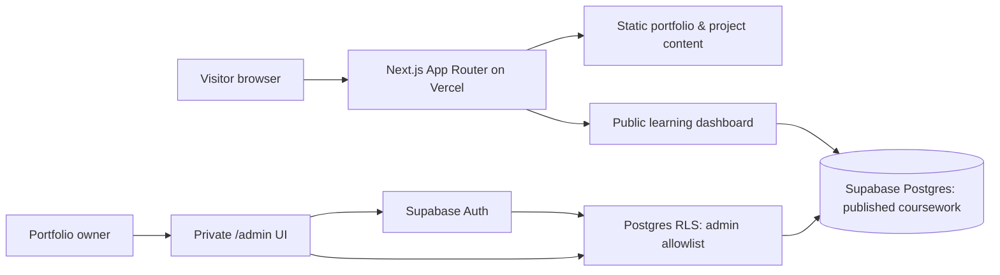

# Solution architecture

## Boundaries

- Visitors have no admin permissions and can read only published database records.
- Content editor is a client component and uses only a public Supabase key; all authority is enforced by Postgres RLS and a private `portfolio_admins` allowlist.
- No open registration, public draft access, or file-upload handling is included in the first version.
- Planned lab project files are static to allow transparent editorial review before publication.
- The nine starter module records are explicitly grounded in supplied screenshots, not a live Microsoft Learn API feed.

## Content lifecycle

1. Owner completes a course and collects a verification URL or screenshot.
2. Owner logs in to `/admin` and creates a draft or published course entry.
3. Postgres verifies owner in `portfolio_admins` with RLS.
4. Published entries appear in public `/learning`; drafts stay in admin.
5. Project blueprints can be updated after lab execution, testing, and a security review of screenshots and scripts.

## Future iterations

- Extend the coursework admin with edit and attachments.
- Add project artifacts (architecture diagram, sanitized Terraform/Bicep source, validation evidence, cost notes).
- Add vetted CI checks: Next build, accessibility, link checking, RLS policy integration tests, and visual regression checks.
- Integrate GitHub only after approving access scopes.
